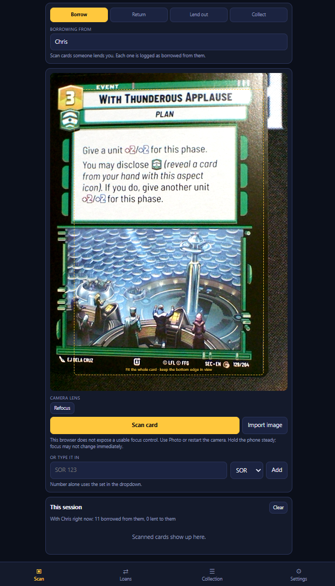

# 🌌 SWU Lend

**SWU Lend** is a lightweight, browser-based utility for Star Wars Unlimited players to track the lending and borrowing of cards. Instead of manual data entry, the app uses on-device OCR to scan the card's footer and automatically identify the card.

## ✨ Features

### 📸 Automated Card Scanning
*   **On-Device OCR:** Uses **ONNX Runtime** and **PaddleOCR** to detect and read set codes and card numbers directly in your browser.
*   **Smart Identification:** Cross-references scanned data with the `swu-db` API to automatically fetch card names, subtitles, and artwork.
*   **Promo Support:** Specifically tuned to recognize both standard fraction-based numbers (e.g., `17/252`) and standalone promo numbers (e.g., `17`).
*   **Advanced Camera Controls:** Includes lens selection (to find the sharpest close-up lens), manual focus sliders, and torch control for low-light environments.

### 🔄 Loan Management
*   **Four-Way Tracking:** 
    *   **Borrow:** Log cards you've taken from others.
    *   **Lend Out:** Log your cards given to others.
    *   **Return:** Quickly mark cards as returned to the original owner.
    *   **Collect:** Add cards directly to your personal digital catalogue.
*   **Person-Based Ledger:** View exactly how many cards are outstanding with a specific person at a glance.

### 📦 Collection & Data
*   **Local-First Storage:** All data is stored in your browser's `localStorage`. Your loan history and collection stay on your device.
*   **Portable Backups:** Export your entire database as a JSON file or import a previous backup to move your data between devices.
*   **Offline Capable:** Once the OCR models are cached by your browser, the app can perform scans without an active internet connection.

## 🛠️ Technical Stack

*   **Frontend:** Vanilla JavaScript, HTML5, CSS3 (Single Page Application).
*   **OCR Engine:** 
    *   **ONNX Runtime Web:** Executes the text recognition models in the browser.
    *   **PaddleOCR:** High-performance text detection and recognition.
*   **Data Source:** Integration with the `api.swu-db.com` for real-time card metadata.
*   **Hosting:** GitHub Pages.

## 📖 How to Use

1. **Set the Mode:** Choose whether you are Borrowing, Lending, or Collecting.
2. **Identify the Person:** If borrowing or lending, enter the name of the other player.
3. **Scan the Card:** 
    * Tap **Start Camera**.
    * Position the card so the footer (the line with the number and set code) is clearly visible.
    * Tap **Scan Card**.
4. **Confirm:** Review the identified card in the pop-up sheet and tap **Add**.

## ⚙️ Configuration

Under the **Settings** tab, you can customize the experience:
*   **API Lookup:** Toggle whether the app should fetch names online.
*   **Auto-Add:** Enable this to skip the confirmation screen when the scan is highly confident.
*   **Set Filtering:** Toggle between showing only current "Premier" sets or all historical sets.

## 🔐 Privacy
SWU Lend is designed with privacy in mind. 
* **No Accounts:** There is no login or registration.
* **No Cloud Storage:** Your loan data is never uploaded to a server.
* **Local Processing:** OCR is performed entirely on your device; the camera stream is never transmitted over the network.

## ☕ Support the Project
This tool is completely free to use and is a labor of love for the SWU community. If it has helped you keep track of your cards and you'd like to show some appreciation, you can support my work here:

👉 **[Buy me a coffee on Ko-fi!] https://ko-fi.com/thingsplusbitsnbobs** ☕
